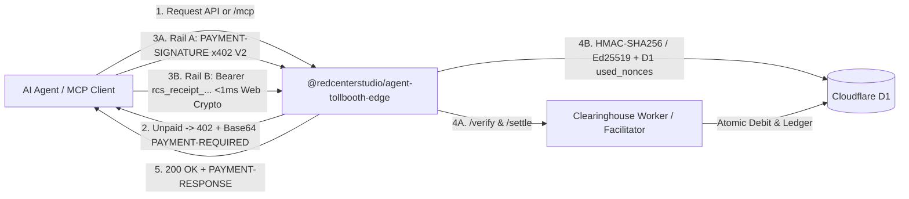

# Agent Tollbooth 402

**Monetize APIs, Cloudflare Workers, Hono apps, and MCP servers in under 60 seconds with dual-rail HTTP 402 payments.**

Built by [Red Center Studio](https://redcenterstudio.com) for both **Google Antigravity** and **Claude Code**.

---

## Dual-Rail Architecture

`agent-tollbooth-402` combines the open **x402 V2** crypto HTTP payment standard with **Red Center Fiat Agent Wallets** so agents can pay `$0.001–$0.10` per call with either on-chain USDC or Stripe-funded prepaid bearer receipts verified in `<1ms` at the edge.



---

## Pricing & Clearinghouse Tiers

| Tier | Pricing | Clearinghouse Fee | Capabilities Included |
| :--- | :--- | :--- | :--- |
| **Free / BYO x402 Mode** | **`$0`** | `0%` (BYO facilitator) | Unlimited `/scan-routes`, zero-dependency middleware injection, `/test-agent` simulator, `exact` x402 V2 scheme with any public or self-hosted facilitator. |
| **Hybrid Fiat + x402 Clearinghouse** | **`$0/mo`** | **`7%`** | Enables Stripe-funded Fiat Agent Wallets (`rcs_receipt_...` `<1ms` edge verification) + automated Stripe Connect payouts via `tollbooth.redcenterstudio.com`. |
| **Tollbooth Pro Pass** | **`$39` one-time** (`$79` Agency) | **`3%`** | Drops clearinghouse fee from `7%` to `3%`, unlocks `upto` dynamic per-token/per-KB metering, custom HTML `402` payment pages, and per-agent spend caps. |
| **Done-For-You Integration** | **From `$399`** | Custom | End-to-end custom MCP + HTTP 402 Tollbooth wrapping, D1 ledger setup, and verification by [Red Center Studio](https://redcenterstudio.com). |

---

## 60-Second Quickstart (Cloudflare Workers & Hono)

### Cloudflare Workers (`withTollbooth`)

```ts
import {
  D1NonceStore,
  usdToMicros,
  withTollbooth,
} from "@redcenterstudio/agent-tollbooth-edge";

interface Env {
  DB: D1Database;
  TOLLBOOTH_PAY_TO_ADDRESS: string;
  RECEIPT_SIGNING_SECRET: string;
}

export default withTollbooth<Env>(
  (env) => ({
    payTo: env.TOLLBOOTH_PAY_TO_ADDRESS,
    facilitatorUrl: "https://tollbooth.redcenterstudio.com",
    nonceStore: new D1NonceStore(env.DB),
    fiatWallet: {
      hmacSecret: env.RECEIPT_SIGNING_SECRET,
      clearinghouseUrl: "https://tollbooth.redcenterstudio.com",
    },
    routes: [
      {
        pattern: "/api/v1/lookup",
        method: "GET",
        scheme: "exact",
        priceMicros: usdToMicros("0.005"), // $0.005 = 5,000 microdollars
        description: "Low-latency lookup endpoint",
      },
    ],
  }),
  {
    async fetch(request, env, ctx) {
      return Response.json({ ok: true, result: "Paid edge payload" });
    },
  },
);
```

### Hono (`honoTollbooth`)

```ts
import { Hono } from "hono";
import {
  MemoryNonceStore,
  honoTollbooth,
  usdToMicros,
} from "@redcenterstudio/agent-tollbooth-edge";

const app = new Hono();

app.use(
  "/api/*",
  honoTollbooth({
    payTo: process.env.TOLLBOOTH_PAY_TO_ADDRESS ?? "0x000000000000000000000000000000000000dEaD",
    proPass: true,
    nonceStore: new MemoryNonceStore(),
    fiatWallet: { hmacSecret: process.env.RECEIPT_SIGNING_SECRET },
    routes: [
      {
        pattern: "/api/pro/generate",
        method: "POST",
        scheme: "upto",
        priceMicros: usdToMicros("0.05"),
        meterUsage: async (_req, res, minAtomic, maxAtomic) => {
          const kb = BigInt(Math.max(1, Math.ceil((await res.clone().text()).length / 1024)));
          const total = minAtomic + kb * 1000n;
          return total > maxAtomic ? maxAtomic : total;
        },
      },
    ],
  }),
);
```

---

## Included Plugin Capabilities (Antigravity + Claude Code)

Install in Claude Code:

```text
/plugin install agent-tollbooth-402 --marketplace redcenterstudio/agent-tollbooth-402
```

- **Remote MCP Server (`mcp_config.json` & `.mcp.json`)**: Connects to `https://tollbooth.redcenterstudio.com/mcp` via Streamable HTTP (`tollbooth_pricing_quote`, `tollbooth_wallet_balance`, `tollbooth_issue_receipt`, `tollbooth_verify_x402`). See our [Privacy Policy](https://redcenterstudio.com/privacy).
- **Skills (`skills/`)**:
  - `scan-routes`: Inventories Cloudflare Workers, Hono, Next.js App Router, and MCP routes and proposes dual-rail pricing tiers.
  - `install-tollbooth`: Wires `@redcenterstudio/agent-tollbooth-edge` with replay-protected D1/memory nonce stores and placeholder env setup.
  - `test-agent`: Executes a local `402` challenge -> signed payment -> `200 OK` retry -> nonce replay rejection smoke test.
- **Scoped Guardrails (`rules/http-402-guardrails.md`)**: Automatically enforces CORS/health exemptions, constant-time Web Crypto verification, nonce replay protection, downstream `5xx` idempotency, integer microdollar accounting, and per-agent spend caps when working on monetization tasks.

---

## Local Development, Validation & Reference Clearinghouse

```bash
npm install
npm run validate
```

`npm run validate` runs:
1. Strict TypeScript checks across `packages/edge-middleware` and `packages/clearinghouse-worker`.
2. Build output for `@redcenterstudio/agent-tollbooth-edge`.
3. Vitest suites covering `402` challenges, x402 V2 `exact` & Pro `upto` metering, HMAC-SHA256 & Ed25519 `<1ms` receipt verification, `D1NonceStore` replay prevention, 7% vs 3% integer ledger math, and Streamable HTTP `/mcp` JSON-RPC 2.0 handlers against an in-memory SQLite D1 adapter executing `migrations/0001_init.sql`.
4. Strict plugin manifest, MCP config, skill frontmatter, and secret-hygiene validation (`scripts/validate-plugin.mjs`).

> **Note on `packages/clearinghouse-worker`:** This is a reference Cloudflare Worker + D1 schema implementation (`wrangler.jsonc` uses placeholder IDs and `.dev.vars.example` contains placeholder secrets). Supply your own D1 database ID and Wrangler secrets before deploying to your own Cloudflare account.

---

## License

[MIT](./LICENSE) — Red Center Studio (`https://redcenterstudio.com`)
