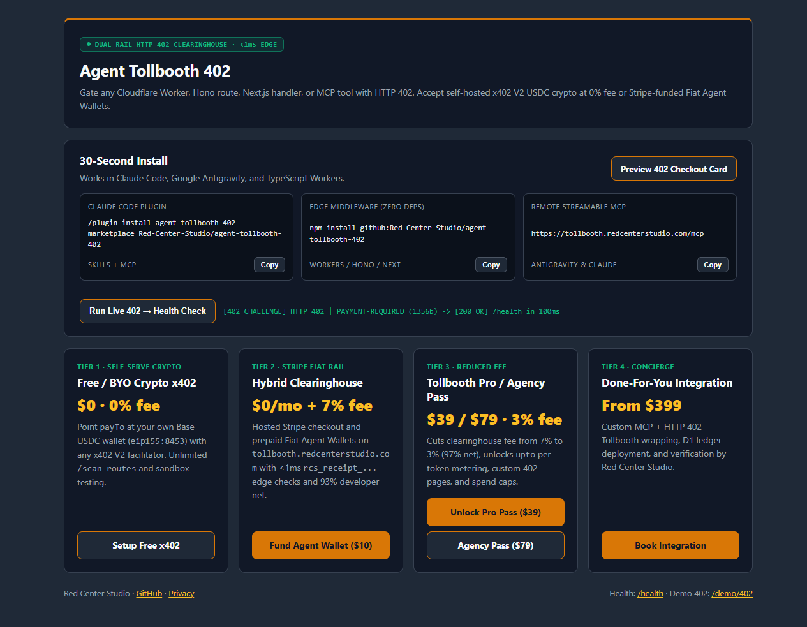
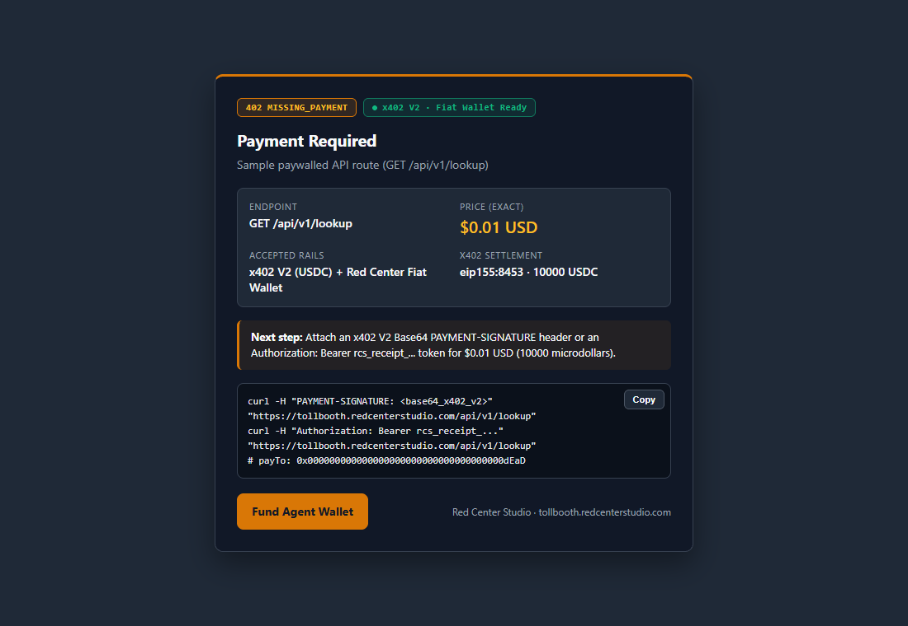
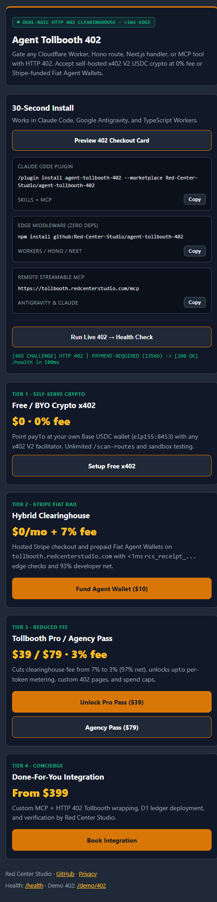
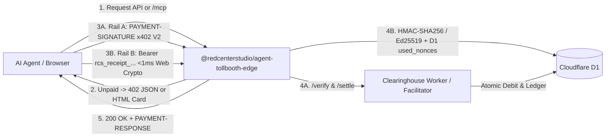

# Agent Tollbooth 402

**Monetize APIs, Cloudflare Workers, Hono apps, Next.js routes, and MCP servers in under 60 seconds with HTTP 402 payments that go straight to your own wallet.**

Built by [Red Center Studio](https://redcenterstudio.com) for **Google Antigravity** and **Claude Code**.

[](https://glama.ai/mcp/servers/Red-Center-Studio/agent-tollbooth-402)
[](https://glama.ai/mcp/connectors/com.redcenterstudio.tollbooth/agent-tollbooth-402)
[](https://tollbooth.redcenterstudio.com/mcp)
[](https://tollbooth.redcenterstudio.com/pay)
[](./LICENSE)

---

## 3-Line Quickstart (30-Second Zero-Config Sandbox)

```bash
npm install
npm run validate
npm run test:sandbox
```

Zero API keys, zero crypto wallets, and zero Stripe setup required to run your first `402 -> sign -> 200 OK` loop locally.

---

## 5-Line `withTollbooth` Setup

Copy-paste into any Cloudflare Worker, Web Fetch handler, or Next.js route:

```ts
import { withTollbooth } from "@redcenterstudio/agent-tollbooth-edge";

export default withTollbooth({ priceUsd: 0.01, mode: "x402", payTo: "0xYourBaseUSDCWallet", network: "eip155:84532" }, async (request) => {
  return Response.json({ ok: true, path: new URL(request.url).pathname });
});
```

- **Local test without wallets or keys:** change `mode: "x402"` to `mode: "sandbox"` and call `createSandboxReceipt()` or `createSandboxX402Header()`.
- **Hono middleware:** `app.use("/api/*", honoTollbooth({ priceUsd: 0.01, mode: "x402", payTo: "0xYourBaseUSDCWallet", network: "eip155:84532" }))`.
- **Cloudflare D1 replay protection:** pass `nonceStore: new D1NonceStore(env.DB)` inside `withTollbooth((env) => ({ ... }), handler)`.

---

## Live Clearinghouse & Screenshots

Live clearinghouse portal & MCP endpoint: `https://tollbooth.redcenterstudio.com` ([/pay](https://tollbooth.redcenterstudio.com/pay) · [/demo/402](https://tollbooth.redcenterstudio.com/demo/402))

- [Setup Walkthrough Video (MP4)](./assets/screenshots/setup-walkthrough.mp4) — copying the install command, running the live `402` check, and inspecting the browser checkout card.



| HTTP 402 Browser Checkout Card | Mobile Responsive Layout (`390px`) |
| :---: | :---: |
|  |  |

---

## Dual-Rail Architecture & Browser 402 Checkout Card

`agent-tollbooth-402` takes **x402 V2** on-chain USDC authorizations paid straight to your `payTo` wallet. The middleware can also verify **Red Center Fiat Agent Wallet** receipts, but prepaid wallets pay Red Center Studio's own routes only, not other developers.

- **Programmatic AI Agents (`Accept: application/json`)**: Receive `402 Payment Required` with Base64 `PAYMENT-REQUIRED`, `WWW-Authenticate`, CORS `Access-Control-Expose-Headers`, `priceUsd`, `acceptedRails`, `code`, and a plain-English `fix_hint`.
- **Human Browser Requests (`Accept: text/html`)**: Receive a responsive Red Center Studio `402` Checkout Card (`#24181a` Ironstone, `#d9622b` Red Ochre, `#e3a23c` Spinifex Gold, `#f5efe6` Sand) displaying endpoint details, price, payment curl snippets, and a **Fund Agent Wallet** action link.



---

## Pricing

| Tier | Price | Fee on your payments | What You Get |
| :--- | :--- | :--- | :--- |
| **Free (DIY)** | **`$0`** | **`0%`** | The connector (MCP server), plugin and skills (`/install-tollbooth`, `/scan-routes`, `/test-agent`), edge middleware, hosted settlement on Base Sepolia testnet (`eip155:84532`), and Base mainnet through your own facilitator. |
| **Tollbooth Pro Pass** | **`$39`** one-time, one project | **`0%`** | Hosted Base mainnet (`eip155:8453`) settlement through `tollbooth.redcenterstudio.com`: no Coinbase developer account, keys or facilitator server of your own. Earnings history (`/developer/ledger`, `tollbooth_ledger_history`) and `upto` metering. Needs the developer account `payoutAddress` to equal your `payTo`. |
| **Agency Pass** | **`$79`** one-time | **`0%`** | The same as Pro for multiple projects and client sites. |
| **Done-For-You Integration** | **From `$499`** | Custom | End-to-end custom MCP + HTTP 402 Tollbooth wrapping, D1 ledger setup, and verification by [Red Center Studio](https://redcenterstudio.com). |

---

Payments always go straight to your own `payTo` wallet in USDC. Red Center Studio never holds your money and takes 0% of payments.

### DIY setup in 4 steps

1. Register a developer account with your Base wallet as the payout address (`POST /developer/register` or the connector).
2. Run `/install-tollbooth` in Claude Code (or add the middleware by hand) with `payTo` set to that wallet.
3. Test free on Base Sepolia with `/test-agent`.
4. Buy a Pro Pass to go live on Base mainnet.

---

## Plugin Installation (Antigravity + Claude Code)

Install in Claude Code:

```text
/plugin install agent-tollbooth-402 --marketplace Red-Center-Studio/agent-tollbooth-402
```

Install in Antigravity (`~/.gemini/config/plugins/`):

```bash
git clone https://github.com/Red-Center-Studio/agent-tollbooth-402.git ~/.gemini/config/plugins/agent-tollbooth-402
```

Install the zero-dependency Edge Middleware in a Worker, Hono, or Next.js project:

```bash
npm install @redcenterstudio/agent-tollbooth-edge
```

- **Remote MCP Server (`mcp_config.json` & `.mcp.json`)**: Connects to `https://tollbooth.redcenterstudio.com/mcp` via Streamable HTTP (`tollbooth_pricing_quote`, `tollbooth_wallet_balance`, `tollbooth_issue_receipt`, `tollbooth_verify_x402`, `tollbooth_create_topup_checkout`, `tollbooth_register_wallet`, `tollbooth_ledger_history`, `tollbooth_pass_status`). See our [Privacy Policy](https://redcenterstudio.com/privacy).
- **Skills (`skills/`)**:
  - `scan-routes`: Audits Cloudflare Workers, Hono, Next.js App Router, Express, and MCP endpoints.
  - `install-tollbooth`: Auto-detects framework, previews diff, and injects 1-step `withTollbooth(...)`.
  - `test-agent`: Runs the 30-second zero-config sandbox `402 -> sign -> 200 OK` smoke test.
- **Scoped Guardrails (`rules/http-402-guardrails.md`)**: Enforces bypass exemptions, constant-time Web Crypto checks, replay protection, downstream `5xx` idempotency, integer microdollar math, and spend caps.

## Accounts, keys and receipts

- `POST /developer/register` creates a developer account and returns a developer key (`rcs_dk_...`), shown once. Send your Base wallet as `payoutAddress`. `POST /wallet/register` creates an empty prepaid agent wallet (`rcs_wk_...`); prepaid wallets pay Red Center Studio's own routes only, not other developers. Only SHA-256 hashes of keys are stored; `POST /keys/rotate` replaces a key.
- A wallet key can read only its own balance and ledger, and can only request receipts that spend from its own wallet.
- Receipts for Red Center Studio routes are signed with Ed25519. They are verified with the public key at `https://tollbooth.redcenterstudio.com/.well-known/tollbooth-jwks.json` and never hold a secret that could mint receipts:

```ts
import { fetchTollboothPublicKey, withTollbooth } from '@redcenterstudio/agent-tollbooth-edge';
const ed25519PublicKey = await fetchTollboothPublicKey(); // cache this
export default withTollbooth({ mode: 'x402', payTo: '0xYourBaseUSDCWallet', fiatWallet: { ed25519PublicKey } }, handler);
```

## x402 settlement

- `/verify` recovers the EIP-712 `TransferWithAuthorization` signer with secp256k1 and checks it is the payer, along with the USDC asset, network, recipient, amount, expiry and replay records.
- `/settle` submits the transfer through an on-chain facilitator: the public x402.org facilitator on Base Sepolia (`eip155:84532`), free. Hosted Base mainnet (`eip155:8453`) settlement needs a Pro or Agency Pass; without one, settle mainnet through your own facilitator. A settlement that cannot run is refused, never faked.
- Payments go straight to your `payTo` wallet, so x402 carries no Red Center fee.

---

## Troubleshooting FAQ

| Error Code | Meaning | Fix (`fix_hint`) |
| :--- | :--- | :--- |
| **`MISSING_PAYMENT`** | Request had neither `PAYMENT-SIGNATURE` nor `Bearer rcs_receipt_...`. | Attach an x402 V2 `PAYMENT-SIGNATURE` header, a Rail B receipt, or use `createSandboxReceipt()` in `mode: "sandbox"`. |
| **`INSUFFICIENT_FUNDS`** | Payment authorization or wallet balance is below `priceMicros`. | Authorize at least `priceMicros` atomic units or top up the agent wallet balance. |
| **`RECEIPT_EXPIRED`** | `exp` / `iat` / `validBefore` fell outside the `+/-30s` clock-skew window. | Re-sign a fresh receipt or x402 authorization using synchronized UTC seconds. |
| **`NONCE_REPLAYED`** | The receipt `jti` or x402 `nonce` was already consumed in `used_nonces`. | Generate a new unique `crypto.randomUUID()` nonce/receipt for every new paid request. |
| **`INVALID_SIGNATURE`** | Web Crypto HMAC/Ed25519 verification failed, or `aud` / `payTo` / `network` mismatched. | Confirm `RECEIPT_SIGNING_SECRET`, `ed25519PublicKey`, `payTo`, and target URL match. |
| **Browser CORS blocked reading headers** | Browser client cannot read `PAYMENT-REQUIRED` or `PAYMENT-RESPONSE`. | Middleware automatically sets `Access-Control-Expose-Headers: PAYMENT-REQUIRED, PAYMENT-RESPONSE, X-Agent-Receipt, WWW-Authenticate, X-Tollbooth-Rail`. |

> **Reference Clearinghouse Note (`packages/clearinghouse-worker`):** Includes placeholder D1 IDs (`wrangler.jsonc`) and `.dev.vars.example` placeholders. Supply your own D1 database and Wrangler secrets before deploying to your own Cloudflare account.

---

## License

[MIT](./LICENSE) — Red Center Studio (`https://redcenterstudio.com`)
